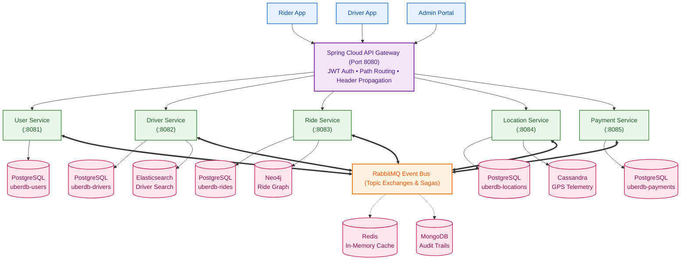
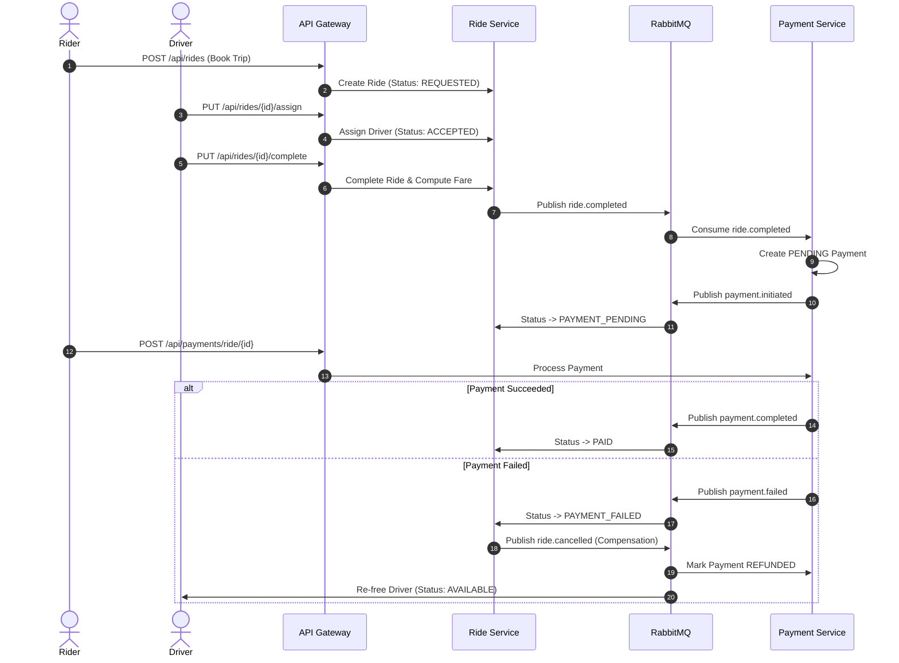

# Uber Ride-Hailing Distributed Platform

[](https://openjdk.org/)
[](https://spring.io/projects/spring-boot)
[](https://spring.io/projects/spring-cloud)
[](https://www.docker.com/)
[](https://kubernetes.io/)

---

## 📌 Project Overview

This project is a scalable, cloud-native **Uber-like ride-hailing backend platform** built with **Spring Boot 4 (Java 25)**. It models real-world ride-hailing operations through a decentralized microservices architecture with polyglot persistence and event-driven communication.

### Key Capabilities
- **Ride Lifecycle**: Trip booking, driver dispatch, multi-stop routes, dynamic surge pricing, and cancellation.
- **Geospatial Discovery**: Driver proximity search using GPS coordinates and stationary driver anomaly detection.
- **Distributed Saga**: Event-driven trip completion, payment processing, and automated compensating refunds on failure.
- **Driver Recommendations**: Graph-based collaborative filtering matching passengers with drivers based on shared trip history.
- **Audit & Caching**: Centralized audit trails for domain events and low-latency read caching.

---

## 🏛️ System Architecture

The platform uses a reactive **API Gateway** as the single entry point for client requests, routing traffic to isolated domain microservices. Services communicate synchronously via **OpenFeign** for reads, and asynchronously through **RabbitMQ** for state changes.



---

## 🧩 Microservices

| Service | Port | Description |
| :--- | :---: | :--- |
| **`api-gateway`** | `8080` | Non-blocking gateway, JWT authentication, path routing, and correlation ID injection. |
| **`user-service`** | `8081` | User registration, authentication (JWT/BCrypt), role management (Rider, Driver, Admin). |
| **`driver-service`** | `8082` | Driver profile lifecycle, availability status (`AVAILABLE`, `BUSY`, `OFFLINE`), documents, and ratings. |
| **`ride-service`** | `8083` | Ride booking, dispatching, surge pricing, trip state machine, and driver recommendations. |
| **`location-service`** | `8084` | Real-time GPS ping ingestion, nearby driver search, and stationary driver tracking. |
| **`payment-service`** | `8085` | Payment processing (Card, Wallet, Cash), coupons, and refund calculation strategies. |
| **`contracts`** | N/A | Shared library for event records, DTOs, and Feign client interfaces. |

---

## 💾 Polyglot Databases & Technologies

The platform leverages 6 specialized storage engines tailored to specific operational requirements:

| Database / Tool | Type | Role in the Project |
| :--- | :--- | :--- |
| **PostgreSQL 17** | Relational (ACID) | **Database-per-Service**: 5 separate databases (`uberdb-users`, `uberdb-drivers`, `uberdb-rides`, `uberdb-locations`, `uberdb-payments`) ensuring complete domain isolation. |
| **MongoDB** | Document Store | Stores immutable domain events and audit trails across all services (`auth_events`, `driver_events`, `ride_events`, `payment_audit_trail`). |
| **Redis** | In-Memory Cache | Caches frequent read queries (driver profiles, ride status, summaries) with custom TTLs and auto-eviction. |
| **Elasticsearch 9** | Search Engine | Powers full-text and fuzzy searches for drivers, vehicle details, and ratings. |
| **Neo4j** | Graph Database | Maps `(:UserNode)-[:RODE_WITH]->(:DriverNode)` to run collaborative filtering queries for driver recommendations. |
| **Apache Cassandra** | Wide-Column Store | Handles high-throughput, time-series ingestion of driver GPS coordinates. |
| **RabbitMQ** | Message Broker | Decouples services via Topic Exchanges and Dead Letter Queues (DLQ) for asynchronous saga workflows. |

---

## 🔄 Ride & Payment Saga Flow

The platform uses a **Choreography-based Saga** to handle the distributed transition from ride completion to payment settlement, with automatic compensation on failure:



---

## 🎨 Design Patterns Implemented

- **Strategy Pattern** (`payment-service`): Dynamic refund logic based on cancellation timing and surge conditions.
- **Observer Pattern** (All Services): Captures domain events and persists them to MongoDB for auditing.
- **Chain of Responsibility** (`api-gateway` & services): Filter pipelines for JWT validation and request context setup.
- **Builder Pattern** (All Services): Construction of complex analytics and summary DTOs.
- **Singleton Pattern** (All Services): Centralized, thread-safe configuration management (`JwtConfigurationManager`).
- **Factory Pattern** (All Services): Polymorphic domain event creation for MongoDB and messaging.
- **Adapter Pattern** (All Services): Converts external NoSQL database records (Neo4j, Cassandra, ES) into standard domain DTOs.

---

## 🚀 Running the Project

### Prerequisites
- Docker & Docker Compose
- Java 25 & Maven 3.9+ (optional for local builds)
- Minikube & kubectl (optional for Kubernetes)

### 1. Run with Docker Compose
```bash
# Build JARs
./mvnw clean package -DskipTests

# Start all databases and microservices
docker compose up -d --build
```

### 2. Available Ports
- **API Gateway**: `http://localhost:8080` (main entry point)
- **RabbitMQ Dashboard**: `http://localhost:15672` (`guest` / `guest`)
- **Neo4j Browser**: `http://localhost:7474` (`neo4j` / `neo4jpass`)
- **Elasticsearch**: `http://localhost:9200`

### 3. Deploy to Kubernetes (Minikube)
```bash
minikube start --cpus=4 --memory=8192
chmod +x k8s/deploy-all.sh
./k8s/deploy-all.sh --build
```
Access the API Gateway via Minikube: `http://$(minikube ip):30080`

---

## 👥 Engineering Team (RandomUnion — Team 10)

| Name | Student ID | Domain |
| :--- | :---: | :--- |
| **Aly Basyouni** | `55-2712` | Driver Service |
| **Abdelrahman Khairat** | `55-0254` | Driver Service |
| **Ziad Mahmoud** | `55-1378` | Driver Service |
| **Youssef Khaled Elshall** | `55-0814` | Location Service |
| **Ahmed Hany** | `55-8293` | Location Service |
| **Amr Hesham** | `55-0839` | Location Service |
| **Nour Shalaby** | `55-15679` | User Service |
| **Ibrahim Ashmawy** | `55-10169` | User Service |
| **Karim Waleed** | `55-15981` | User Service |
| **Youssef Abdulazim** | `55-1876` | Ride Service |
| **Zeiad Elenani** | `55-1117` | Ride Service |
| **Mohamed Elayadi** | `43-2918` | Ride Service |
| **Youssef Elbatrawy** | `55-2005` | Payment Service |
| **Kerollos Ashraf** | `55-25131` | Payment Service |

---

## 📜 License & Academic Context
Developed for the **Architecture of Massively Scalable Applications** course at the **German University in Cairo (GUC)** under the supervision of **Assoc. Prof. Mervat Abu El-Kheir**.
