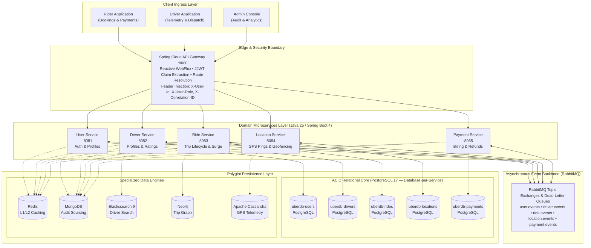
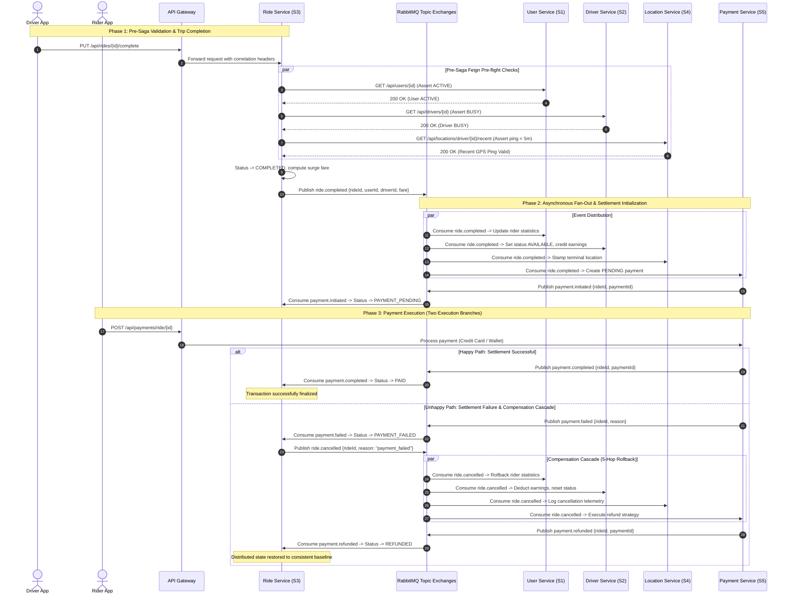
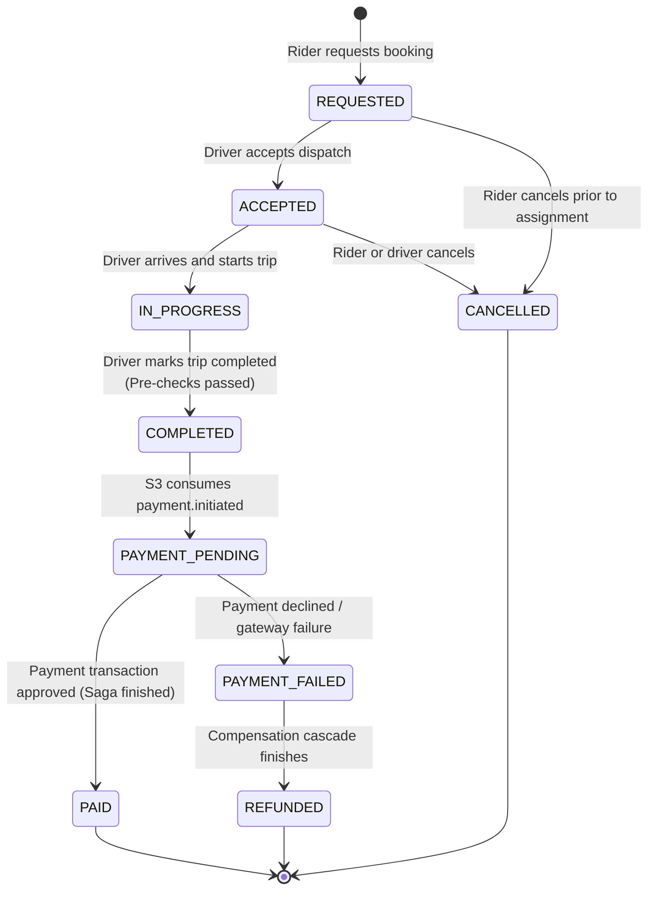
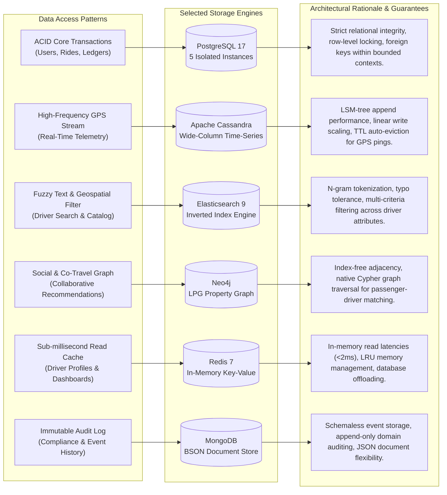
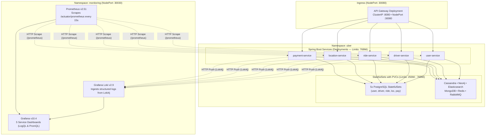
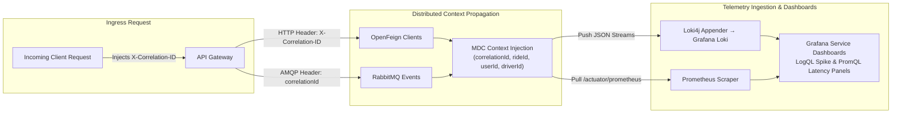

# Uber Distributed Ride-Hailing Platform

[](https://openjdk.org/)
[](https://spring.io/projects/spring-boot)
[](https://spring.io/projects/spring-cloud)
[](https://kubernetes.io/)
[](https://www.docker.com/)
[](https://www.postgresql.org/)
[](https://www.rabbitmq.com/)
[](https://redis.io/)
[](https://neo4j.com/)
[](https://cassandra.apache.org/)
[](https://www.elastic.co/)

A production-grade, polyglot distributed ride-hailing backend engineered with Spring Boot 4 and Java 25. The platform implements database-per-service isolation, an event-driven choreography Saga over RabbitMQ with automatic 5-hop compensating transactions, high-frequency GPS telemetry ingestion, graph-based collaborative matching, and cloud-native Kubernetes orchestration with dedicated observability pipelines.

---

## Architecture Navigation

- [System Architecture & Ingress](#system-architecture--ingress)
- [Microservice Boundaries & Responsibilities](#microservice-boundaries--responsibilities)
- [Distributed Saga & Event Choreography](#distributed-saga--event-choreography)
- [Ride Lifecycle State Machine](#ride-lifecycle-state-machine)
- [Polyglot Storage & Telemetry Pipelines](#polyglot-storage--telemetry-pipelines)
- [Cloud-Native Kubernetes Deployment](#cloud-native-kubernetes-deployment)
- [Enterprise Observability & Telemetry](#enterprise-observability--telemetry)
- [Design Patterns Implementation](#design-patterns-implementation)
- [Local Development & Quickstart](#local-development--quickstart)
- [Architectural Evolution & Roadmap](#architectural-evolution--roadmap)
- [Engineering Team & Attribution](#engineering-team--attribution)

---

## System Architecture & Ingress

The platform operates as a decentralized microservices mesh fronted by a reactive Spring Cloud Gateway. Ingress traffic undergoes non-blocking JWT authentication, claim extraction, and correlation injection before routing downstream. Domain services communicate synchronously via declarative OpenFeign clients for read-side queries, and asynchronously via RabbitMQ Topic Exchanges for state transitions and saga orchestration.



### Core Architecture Highlights

1. **Database-per-Service Isolation**: Each microservice maintains complete encapsulation over its private PostgreSQL database. Direct cross-database joins and foreign keys are eliminated. Cross-service entity references are stored as plain IDs and resolved via Feign client contracts.
2. **Context Propagation & Defense in Depth**: The API Gateway verifies the JWT token, strips invalid requests, and forwards parsed claims downstream (`X-User-Id`, `X-User-Role`, and `X-Correlation-ID`). Internal services retain a servlet-based filter validating headers, ensuring zero-trust communication across cluster boundaries.
3. **Resilient Inter-Service RPC**: Inter-service read queries use OpenFeign interfaces centralized in the shared `contracts` module. Feign calls enforce strict request timeouts, error decoders, and circuit-safe degradation.

---

## Microservice Boundaries & Responsibilities

The system is decomposed into 5 autonomous domain services plus the edge gateway and shared contracts library:

| Service | Port | Database | Primary Responsibilities | Core Endpoints |
| :--- | :---: | :--- | :--- | :--- |
| **`api-gateway`** | `8080` | None (Stateless) | Ingress routing, reactive JWT verification, claim extraction, header propagation, correlation tracing. | `/api/auth/**`<br/>`/api/{users,drivers,rides,locations,payments}/**` |
| **`user-service`** | `8081` | `uberdb-users`<br/>MongoDB, Redis | User account registration, JWT credential issuance, role RBAC (`RIDER`, `DRIVER`, `ADMIN`), profile management. | `POST /api/auth/register`<br/>`POST /api/auth/login`<br/>`GET /api/users/{id}` |
| **`driver-service`** | `8082` | `uberdb-drivers`<br/>Elasticsearch, Mongo, Redis | Driver profiles, status lifecycle (`AVAILABLE`, `BUSY`, `OFFLINE`), document verification, rating aggregates. | `GET /api/drivers/search`<br/>`PUT /api/drivers/{id}/status`<br/>`GET /api/drivers/{id}/dashboard` |
| **`ride-service`** | `8083` | `uberdb-rides`<br/>Neo4j, Mongo, Redis | Ride creation, dispatch algorithms, surge pricing calculation, ride state machine, graph-based recommendations. | `POST /api/rides`<br/>`PUT /api/rides/{id}/complete`<br/>`PUT /api/rides/{id}/cancel` |
| **`location-service`** | `8084` | `uberdb-locations`<br/>Cassandra, Mongo, Redis | High-velocity GPS telemetry ingestion, driver proximity search, stationary driver anomaly detection. | `POST /api/locations/ping`<br/>`GET /api/locations/nearby`<br/>`GET /api/locations/driver/{id}/recent` |
| **`payment-service`** | `8085` | `uberdb-payments`<br/>MongoDB, Redis | Payment processing (Card, Wallet, Cash), coupon validation, dynamic refund strategy execution. | `POST /api/payments/ride/{id}`<br/>`POST /api/payments/refund`<br/>`GET /api/payments/ride/{id}` |
| **`contracts`** | N/A | None (Library) | Centralized Maven library defining shared event records, DTOs, and `@FeignClient` interfaces. | N/A |

---

## Distributed Saga & Event Choreography

When completing or cancelling rides, business transactions span multiple microservices. In the absence of distributed 2PC locking, the platform guarantees eventual consistency through an **Asynchronous Choreography Saga** with forward settlement and an automated 5-hop compensating rollback cascade.



### Saga Failure Handling & Compensation Guarantees

1. **Pre-Saga Validation Gate**: Before publishing `ride.completed`, `ride-service` executes 3 synchronous Feign pre-checks against `user-service`, `driver-service`, and `location-service`. If the passenger is deactivated, the driver is not currently `BUSY`, or the driver's latest GPS ping is older than 5 minutes, the operation halts with HTTP 400. No events are emitted, avoiding false saga triggers.
2. **Eventual Consistency & DLQs**: RabbitMQ consumers are configured with dedicated Dead Letter Queues (`*.dlq`) and exponential backoff retry. Poison messages that cannot be processed are routed to DLQs without stalling the message bus.
3. **Idempotent Consumers**: Every consumer verifies whether the local entity state already reflects the event before applying mutations. Duplicate deliveries caused by network retries result in safe no-ops.

---

## Ride Lifecycle State Machine

Ride transitions are governed by a deterministic Finite State Machine (FSM) enforcing valid progression across both synchronous requests and asynchronous saga events:



---

## Polyglot Storage & Telemetry Pipelines

Ride-hailing workloads exhibit divergent throughput, query latency, and data structural requirements. Rather than forcing all access patterns into a single relational schema, the platform routes distinct data streams to 6 specialized storage engines:



### Storage Engine Technical Matrix

| Engine | Service Owner | Primary Data Entity | Access Pattern | Architectural Justification |
| :--- | :--- | :--- | :--- | :--- |
| **PostgreSQL 17** | All Services | Users, Drivers, Rides, Locations, Payments | Strong ACID transactions, row-level concurrency, indexed lookups | Guarantees transactional isolation for financial and lifecycle state. Split into 5 standalone instances to enforce strict domain boundaries. |
| **Apache Cassandra** | `location-service` | `driver_locations` | High-write time-series GPS coordinates (`driver_id`, `timestamp`) | Handles continuous write-heavy telemetry streams without read-write contention. Partitioned by `driver_id` for instant temporal retrieval. |
| **Elasticsearch 9** | `driver-service` | `drivers` index | Fuzzy name search, license plate indexing, vehicle classification | Powers search-as-you-type and fuzzy multi-attribute queries that would degrade relational database performance. |
| **Neo4j** | `ride-service` | `(:UserNode)-[:RODE_WITH]->(:DriverNode)` | Graph traversals, co-occurrence path queries, collaborative filtering | Computes personalized driver recommendations using Cypher graph traversal based on shared ride history and ratings. |
| **Redis 7** | All Services | Cache keys (`driver:profile:*`, `ride:status:*`, `dashboard:*`) | Key-value lookups with TTL expiration and LRU eviction policy | Protects relational backends from high-frequency read spikes for frequently requested driver dashboards and ride states. |
| **MongoDB** | All Services | `auth_events`, `driver_events`, `ride_events`, `payment_audit_trail` | Append-only event ingestion, document querying | Stores immutable domain event streams captured by Observer listeners for regulatory compliance and audit trails. |

---

## Cloud-Native Kubernetes Deployment

The production architecture deploys to Kubernetes (Minikube-ready) structured across two physically separated namespaces to isolate platform workloads from telemetry infrastructure:

- **`uber` Namespace**: Hosts the 5 Spring Boot application deployments, API Gateway, 5 PostgreSQL StatefulSets, Cassandra, Neo4j, Elasticsearch, Redis, MongoDB, and RabbitMQ.
- **`monitoring` Namespace**: Hosts the telemetry stack (Loki StatefulSet, Prometheus Deployment, Grafana Deployment).



### Kubernetes Manifest Architecture

```
k8s/
├── namespaces/
│   ├── namespace.yaml                    # Application namespace: uber
│   └── monitoring-namespace.yaml         # Observability namespace: monitoring
├── secrets/                              # Base64 credentials & JWT secrets
├── configmaps/                           # Per-service environment configuration
├── pvcs/                                 # Persistent volume claims for databases
├── statefulsets/                         # Stateful workloads (PostgreSQL, NoSQL, Broker)
├── deployments/                          # Application microservice workloads
├── services/                             # ClusterIP & Headless internal services
├── api-gateway/                          # Gateway Deployment & NodePort Service (30080)
├── monitoring/                           # Loki, Prometheus, and Grafana manifests
└── deploy-all.sh                         # Automated deployment orchestration script
```

---

## Enterprise Observability & Telemetry

Observability is embedded directly into the runtime through distributed tracing headers, structured JSON log streaming, and time-series metric collection:



1. **MDC Correlation Tracing**: An `X-Correlation-ID` header is attached at the API Gateway and propagated across HTTP Feign calls and RabbitMQ message headers. Each service's servlet filter and AMQP listeners inject the correlation ID alongside domain entity IDs (`userId`, `driverId`, `rideId`, `paymentId`, `routingKey`) into SLF4J MDC.
2. **Structured Logging via Loki4j**: Log events are formatted as JSON and shipped asynchronously to Grafana Loki via the `loki-logback-appender`. LogQL queries allow real-time tracing of an individual ride lifecycle across all 5 microservices using its correlation ID.
3. **Prometheus Metrics & Service Dashboards**: Spring Boot Actuator exposes Micrometer metrics scraped every 15 seconds. Each service includes a pre-configured Grafana dashboard featuring:
   - **PromQL Panels**: HTTP request throughput, P50/P95/P99 latency percentiles, JVM heap & GC pressure, HikariCP connection pool saturation.
   - **LogQL Panels**: Real-time error rate detection, correlation ID transaction traces, RabbitMQ publish/consume velocity, slow operation alerts (>1000ms).

---

## Design Patterns Implementation

The codebase adheres to Gang of Four (GoF) structural, behavioral, and creational design patterns to decouple business rules and promote extensibility:

| Pattern | Architectural Location | Concrete Implementation |
| :--- | :--- | :--- |
| **Strategy Pattern** | `payment-service` | Dynamic calculation of cancellation fees and refund percentages based on elapsed time, driver assignment state, and surge conditions. |
| **Observer Pattern** | All Services | Captures business domain events (e.g., `DriverRatedEvent`, `RidePlacedEvent`) and asynchronously logs them into MongoDB audit collections. |
| **Chain of Responsibility** | `api-gateway` & Services | Ordered security filter pipeline: reactive JWT parsing, claim decoding, header mutation, and correlation ID generation. |
| **Builder Pattern** | All Services | Type-safe construction of composite analytics DTOs (`DriverDashboardDTO`, `RideSummaryDTO`) aggregated across multiple data engines. |
| **Singleton Pattern** | All Services | Centralized, thread-safe configuration management (`JwtConfigurationManager`) ensuring atomic cryptographic key caching. |
| **Factory Pattern** | All Services | Polymorphic instantiation of domain event records and MongoDB audit document models. |
| **Adapter Pattern** | All Services | Translates specialized NoSQL records (Cassandra rows, Neo4j graph nodes, Elasticsearch search hits) into unified domain DTOs. |

---

## Local Development & Quickstart

### Prerequisites

- **Java 25** (OpenJDK) & **Maven 3.9+**
- **Docker Engine 24+** & **Docker Compose v2+**
- **Minikube & kubectl** (for Kubernetes deployment)

### 1. Build Multi-Module Artifacts

```bash
# Build contracts and all microservices
./mvnw clean package -DskipTests
```

### 2. Launch Platform via Docker Compose

```bash
# Boot 5 PostgreSQL databases, 5 NoSQL engines, RabbitMQ, 5 services, and API Gateway
docker compose up -d --build
```

Verify container readiness:
```bash
docker compose ps
```

### 3. Port Allocation & Administrative Interfaces

| Component | Host Port | Internal Port | Credentials / Notes |
| :--- | :---: | :---: | :--- |
| **API Gateway** | `8080` | `8080` | Main ingress endpoint (`http://localhost:8080`) |
| **User Service** | `8081` | `8080` | Internal microservice |
| **Driver Service** | `8082` | `8080` | Internal microservice |
| **Ride Service** | `8083` | `8080` | Internal microservice |
| **Location Service** | `8084` | `8080` | Internal microservice |
| **Payment Service** | `8085` | `8080` | Internal microservice |
| **RabbitMQ Management** | `15672` | `15672` | UI: `guest` / `guest` (`amqp://localhost:5672`) |
| **Neo4j Browser** | `7474` | `7474` | UI: `neo4j` / `neo4jpass` (`bolt://localhost:7687`) |
| **Elasticsearch** | `9200` | `9200` | REST API (`http://localhost:9200`) |
| **MongoDB** | `27017` | `27017` | `root` / `rootpass` (`ubermongo`) |
| **Redis** | `6379` | `6379` | Password: `redispass` |
| **Apache Cassandra** | `9042` | `9042` | CQL native port |

### 4. End-to-End Verification (Smoke Test)

```bash
# 1. Register a Rider
curl -s -X POST http://localhost:8080/api/auth/register \
  -H "Content-Type: application/json" \
  -d '{"name":"Alice Smith","email":"alice@example.com","password":"Password123!","role":"RIDER"}'

# 2. Authenticate and retrieve JWT
TOKEN=$(curl -s -X POST http://localhost:8080/api/auth/login \
  -H "Content-Type: application/json" \
  -d '{"email":"alice@example.com","password":"Password123!"}' | jq -r .token)

# 3. Book a Ride via API Gateway
curl -s -X POST http://localhost:8080/api/rides \
  -H "Authorization: Bearer $TOKEN" \
  -H "Content-Type: application/json" \
  -d '{"userId":1,"pickupLocation":"30.0444,31.2357","dropoffLocation":"30.0131,31.2089"}'
```

### 5. Deploy to Kubernetes (Minikube)

```bash
# Start Minikube with required memory allocation
minikube start --cpus=4 --memory=8192

# Execute automated deployment script
chmod +x k8s/deploy-all.sh
./k8s/deploy-all.sh --build

# Access API Gateway via NodePort
GATEWAY_URL="http://$(minikube ip):30080"
curl "$GATEWAY_URL/actuator/health"
```

---

## Architectural Evolution & Roadmap

The platform was built through an iterative, milestone-driven engineering process transitioning from a monolithic relational design to a production-grade distributed architecture:

```mermaid
flowchart LR
    subgraph M1 ["Phase 1: Foundation"]
        direction TB
        M1_A["Single Shared PostgreSQL"]
        M1_B["Cross-Service SQL Joins"]
        M1_C["45 Core Business Endpoints"]
        M1_D["Monolithic Transactions"]
    end

    subgraph M2 ["Phase 2: Polyglot & Design Patterns"]
        direction TB
        M2_A["6 Polyglot Storage Engines"]
        M2_B["7 GoF Design Patterns"]
        M2_C["Neo4j Recommendation Engine"]
        M2_D["Cassandra GPS Telemetry Pipeline"]
    end

    subgraph M3 ["Phase 3: True Microservices & K8s"]
        direction TB
        M3_A["Database-per-Service Isolation"]
        M3_B["Declarative OpenFeign RPC"]
        M3_C["RabbitMQ Choreography Saga"]
        M3_D["Spring Cloud Gateway WebFlux"]
        M3_E["Kubernetes StatefulSets & Probes"]
        M3_F["Loki4j + Prometheus Telemetry"]
    end

    subgraph M4 ["Phase 4: Future Scale & Hardening"]
        direction TB
        M4_A["Apache Kafka Streaming Tier"]
        M4_B["Redis GEO Geohash Sharding"]
        M4_C["OpenTelemetry & Grafana Tempo"]
        M4_D["Istio Service Mesh with mTLS"]
    end

    M1 ==> M2 ==> M3 -. Planned .-> M4
```



### Future Engineering Enhancements

- [ ] **Apache Kafka Migration**: Introduce Kafka log-compacted topics for high-throughput driver location streaming, supplementing RabbitMQ for transactional sagas.
- [ ] **Geohash Sharding via Redis GEO**: Implement `GEOADD` and `GEORADIUS` spatial indexing in Redis for sub-millisecond proximity matching.
- [ ] **Distributed Tracing with Tempo**: Upgrade Loki/Prometheus into a complete Grafana LGTM stack by adding Grafana Tempo and OpenTelemetry instrumentation.
- [ ] **Service Mesh (Istio)**: Enforce mTLS encryption between service pods and introduce Canary deployment traffic splitting.

---

## Engineering Team & Attribution

Developed by **RandomUnion (Team 10)** for the **Architecture of Massively Scalable Applications** course at the **German University in Cairo (GUC)** under the academic supervision of **Assoc. Prof. Mervat Abu El-Kheir**.

| Engineer | Student ID | Domain Responsibility | GitHub Profile |
| :--- | :---: | :--- | :--- |
| **Aly Basyouni** | `55-2712` | Driver Service | [@Basyo2003](https://github.com/Basyo2003) |
| **Abdelrahman Khairat** | `55-0254` | Driver Service | [@Abdelrahmankhairat](https://github.com/Abdelrahmankhairat) |
| **Ziad Mahmoud** | `55-1378` | Driver Service | [@ZiadTMahmoud](https://github.com/ZiadTMahmoud) |
| **Youssef Khaled Elshall** | `55-0814` | Location Service | [@Usifkhalid](https://github.com/Usifkhalid) |
| **Ahmed Hany** | `55-8293` | Location Service | [@Shahh03](https://github.com/Shahh03) |
| **Amr Hesham** | `55-0839` | Location Service | [@Amrhesham1](https://github.com/Amrhesham1) |
| **Nour Shalaby** | `55-15679` | User Service | [@nour-shalaby](https://github.com/nour-shalaby) |
| **Ibrahim Ashmawy** | `55-10169` | User Service | [@ibrahim-ashmawy](https://github.com/ibrahim-ashmawy) |
| **Karim Waleed** | `55-15981` | User Service | [@Kareemwaleed1](https://github.com/Kareemwaleed1) |
| **Youssef Abdulazim** | `55-1876` | Ride Service | [@YoussefAmattar](https://github.com/YoussefAmattar) |
| **Zeiad Elenani** | `55-1117` | Ride Service | [@Zeiadenani](https://github.com/Zeiadenani) |
| **Mohamed Elayadi** | `43-2918` | Ride Service | [@ayadi99](https://github.com/ayadi99) |
| **Youssef Elbatrawy** | `55-2005` | Payment Service | [@youssefelbatrawy](https://github.com/youssefelbatrawy) |
| **Kerollos Ashraf** | `55-25131` | Payment Service | [@Kerollos289](https://github.com/Kerollos289) |

---

## License

This project is licensed under the academic evaluation guidelines of the German University in Cairo. All source code is developed for educational and portfolio demonstration purposes.
