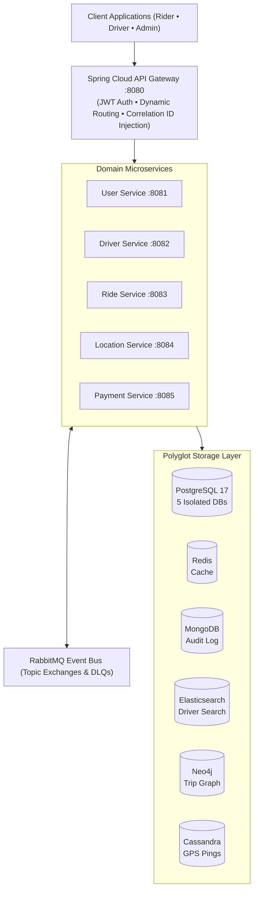
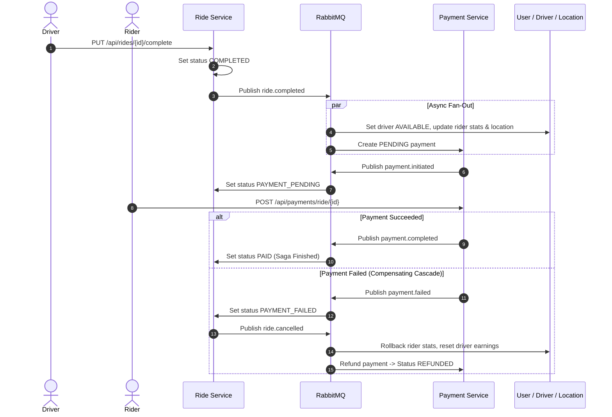

# Uber Distributed Ride-Hailing Platform

[](https://openjdk.org/)
[](https://spring.io/projects/spring-boot)
[](https://spring.io/projects/spring-cloud)
[](https://kubernetes.io/)
[](https://www.docker.com/)
[](https://www.postgresql.org/)
[](https://www.rabbitmq.com/)
[](https://redis.io/)
[](https://neo4j.com/)
[](https://cassandra.apache.org/)
[](https://www.elastic.co/)

A distributed, polyglot ride-hailing backend built with **Spring Boot 4** and **Java 25**. It implements database-per-service isolation, an event-driven choreography Saga over RabbitMQ with automated compensation, high-throughput GPS telemetry ingestion, and Kubernetes orchestration.

---

## System Architecture

Traffic enters through a reactive Spring Cloud Gateway, which validates JWT credentials and propagates correlation IDs. Domain microservices communicate synchronously via OpenFeign for reads and asynchronously via RabbitMQ for writes and saga events.



---

## Services Overview

| Service | Port | Primary Database | Key Responsibilities |
| :--- | :---: | :--- | :--- |
| **`api-gateway`** | `8080` | None (Stateless) | Ingress routing, reactive JWT validation, correlation ID injection. |
| **`user-service`** | `8081` | `uberdb-users` (PostgreSQL) | Authentication (JWT), user registration, role RBAC (`RIDER`, `DRIVER`, `ADMIN`). |
| **`driver-service`** | `8082` | `uberdb-drivers` (PostgreSQL) | Driver profiles, status tracking (`AVAILABLE`, `BUSY`, `OFFLINE`), ratings, fuzzy search (Elasticsearch). |
| **`ride-service`** | `8083` | `uberdb-rides` (PostgreSQL) | Booking lifecycle, surge pricing, driver recommendation graph (Neo4j). |
| **`location-service`** | `8084` | `uberdb-locations` (PostgreSQL) | Real-time GPS ping ingestion (Cassandra), nearby driver discovery. |
| **`payment-service`** | `8085` | `uberdb-payments` (PostgreSQL) | Payment settlement (Card, Wallet, Cash), coupons, dynamic refund calculation. |
| **`contracts`** | N/A | None (Library) | Shared DTOs, RabbitMQ event payloads, and OpenFeign client interfaces. |

---

## Distributed Saga (Ride Completion & Settlement)

Distributed transactions between ride completion and payment settlement are managed via a **Choreography Saga**. On payment failure, an automated 5-hop rollback cascade restores all services to a consistent state.



---

## Polyglot Persistence

Each storage engine handles workloads tailored to its access pattern:

| Engine | Service | Primary Role | Why Selected |
| :--- | :--- | :--- | :--- |
| **PostgreSQL 17** | All Services | Core transactional data (5 isolated DBs) | ACID guarantees, row-level locking, strict domain encapsulation. |
| **Cassandra** | `location-service` | High-frequency GPS ping streams | High-write throughput, LSM-tree appends, TTL expiration. |
| **Elasticsearch 9** | `driver-service` | Driver catalog search | Fuzzy search, n-gram matching, multi-criteria filtering. |
| **Neo4j** | `ride-service` | Passenger-driver trip graph | Native Cypher traversals for collaborative driver recommendations. |
| **Redis 7** | All Services | In-memory read cache | Sub-millisecond response times, LRU eviction for frequent queries. |
| **MongoDB** | All Services | Audit trail & domain events | Schemaless event storage for immutable audit logging. |

---

## Architecture Evolution

```mermaid
flowchart LR
    subgraph M1 ["Milestone 1: Foundation"]
        M1_1["Shared PostgreSQL DB"]
        M1_2["45 Business Endpoints"]
        M1_3["Cross-Service SQL Joins"]
    end

    subgraph M2 ["Milestone 2: Polyglot & Patterns"]
        M2_1["6 Polyglot Storage Engines"]
        M2_2["7 GoF Design Patterns"]
        M2_3["Neo4j Graph & Cassandra Telemetry"]
    end

    subgraph M3 ["Milestone 3: Microservices & K8s"]
        M3_1["Database-per-Service Isolation"]
        M3_2["RabbitMQ Choreography Saga"]
        M3_3["Spring Cloud Gateway & Minikube"]
    end

    M1 --> M2 --> M3
```



---

## Quickstart

### Prerequisites
- Docker & Docker Compose
- Java 25 & Maven 3.9+ (optional for local builds)
- Minikube & kubectl (optional for Kubernetes)

### 1. Run with Docker Compose
```bash
# Build multi-module JARs
./mvnw clean package -DskipTests

# Start all databases and microservices
docker compose up -d --build
```

### 2. Service Endpoints & Dashboards
- **API Gateway**: `http://localhost:8080` (main entry point)
- **RabbitMQ UI**: `http://localhost:15672` (`guest` / `guest`)
- **Neo4j Browser**: `http://localhost:7474` (`neo4j` / `neo4jpass`)
- **Elasticsearch**: `http://localhost:9200`

### 3. Deploy to Kubernetes
```bash
minikube start --cpus=4 --memory=8192
chmod +x k8s/deploy-all.sh
./k8s/deploy-all.sh --build
```
Access the gateway via NodePort: `http://$(minikube ip):30080`

---

## Team & Attribution

Developed by **RandomUnion (Team 10)** for the **Architecture of Massively Scalable Applications** course at the **German University in Cairo (GUC)** under the supervision of **Assoc. Prof. Mervat Abu El-Kheir**.

| Member | Student ID | Domain | GitHub |
| :--- | :---: | :--- | :--- |
| **Aly Basyouni** | `55-2712` | Driver Service | [@Basyo2003](https://github.com/Basyo2003) |
| **Abdelrahman Khairat** | `55-0254` | Driver Service | [@Abdelrahmankhairat](https://github.com/Abdelrahmankhairat) |
| **Ziad Mahmoud** | `55-1378` | Driver Service | [@ZiadTMahmoud](https://github.com/ZiadTMahmoud) |
| **Youssef Khaled Elshall** | `55-0814` | Location Service | [@Usifkhalid](https://github.com/Usifkhalid) |
| **Ahmed Hany** | `55-8293` | Location Service | [@Shahh03](https://github.com/Shahh03) |
| **Amr Hesham** | `55-0839` | Location Service | [@Amrhesham1](https://github.com/Amrhesham1) |
| **Nour Shalaby** | `55-15679` | User Service | [@nour-shalaby](https://github.com/nour-shalaby) |
| **Ibrahim Ashmawy** | `55-10169` | User Service | [@ibrahim-ashmawy](https://github.com/ibrahim-ashmawy) |
| **Karim Waleed** | `55-15981` | User Service | [@Kareemwaleed1](https://github.com/Kareemwaleed1) |
| **Youssef Abdulazim** | `55-1876` | Ride Service | [@YoussefAmattar](https://github.com/YoussefAmattar) |
| **Zeiad Elenani** | `55-1117` | Ride Service | [@Zeiadenani](https://github.com/Zeiadenani) |
| **Mohamed Elayadi** | `43-2918` | Ride Service | [@ayadi99](https://github.com/ayadi99) |
| **Youssef Elbatrawy** | `55-2005` | Payment Service | [@youssefelbatrawy](https://github.com/youssefelbatrawy) |
| **Kerollos Ashraf** | `55-25131` | Payment Service | [@Kerollos289](https://github.com/Kerollos289) |
